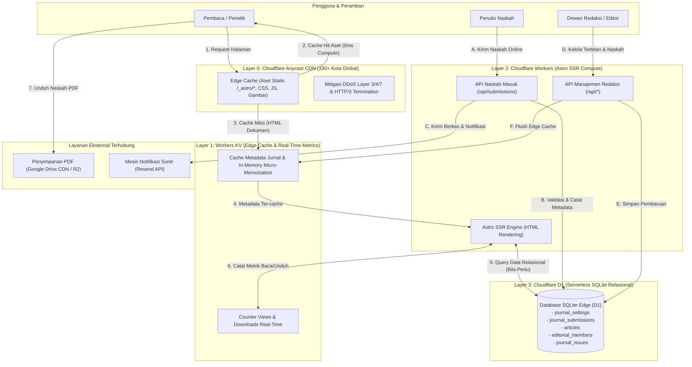
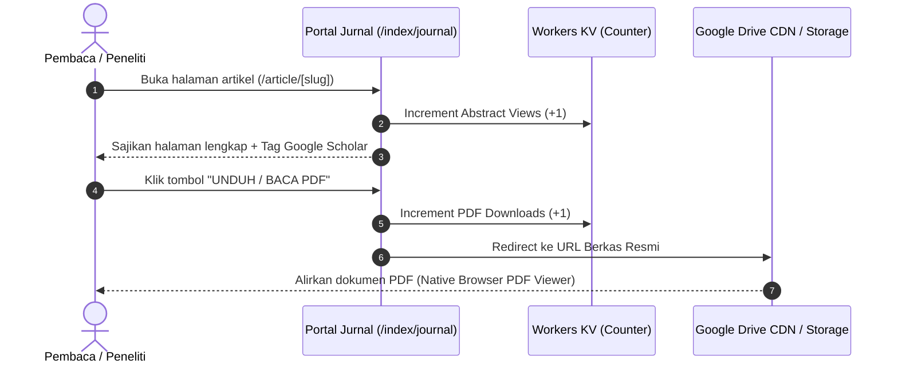
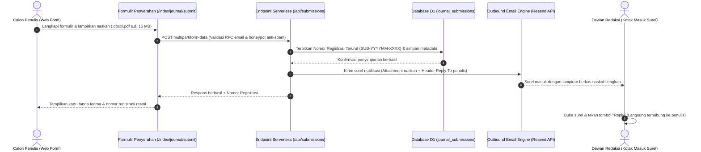
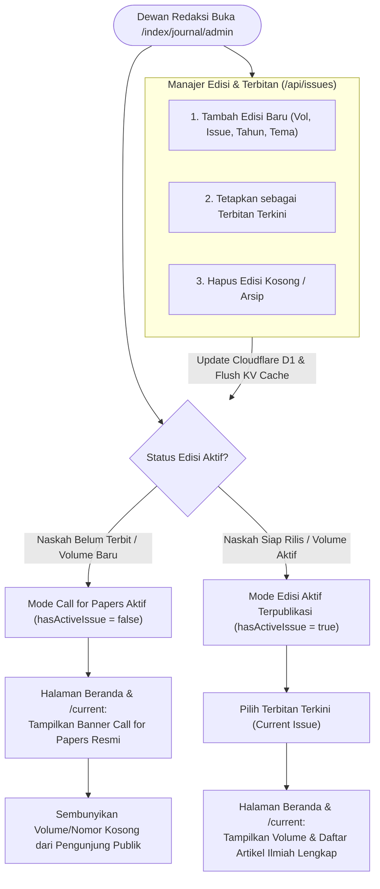

# Serverless Open Journal System (OJS)

Platform web publikasi jurnal ilmiah modern berbasis **Astro + Tailwind CSS** yang dirancang untuk di-host **100% tanpa biaya operasional (Rp 0)** di atas infrastruktur serverless **Cloudflare Pages**, **Cloudflare D1** (SQLite Relasional di Edge), dan **Cloudflare Workers KV** (Global Edge Cache & Real-Time Metrics). Mempertahankan presisi estetika klasik Open Journal Systems (OJS) dengan kecepatan pemuatan halaman edge ultra-cepat dan keandalan tinggi.

---

## 1. Latar Belakang: Mengapa Project Ini Dibangun?

Di Indonesia dan banyak negara berkembang, ribuan jurnal ilmiah yang dikelola oleh program studi, fakultas, asosiasi profesi, maupun lembaga riset nirlaba menggunakan perangkat lunak **PKP OJS (Public Knowledge Project OJS 3.x)**. 

Meskipun PKP OJS adalah standar bersejarah publikasi akademik, dalam realitas operasional di lapangan untuk jurnal skala menengah ke bawah sering kali muncul berbagai kendala kritis:

1. **Krisis Hosting & Sering Down (Downtime saat Akreditasi):**  
   OJS monolitik berbasis PHP dan MySQL membutuhkan alokasi memori besar (*PHP-FPM* + *connection pool*). Pada *shared hosting* berbiaya hemat (Rp 30.000 – Rp 100.000/bulan), website jurnal sering mengalami `500 Internal Server Error` atau `504 Gateway Timeout` ketika asesor akreditasi (SINTA/Arjuna) atau penulis membuka puluhan tab naskah secara bersamaan.
2. **Beban Biaya Infrastruktur Bulanan/Tahunan:**  
   Untuk menjaga OJS tetap stabil, pengelola terpaksa menyewa Virtual Private Server (VPS) dan lisensi cPanel (Rp 300.000 – Rp 800.000/bulan)—biaya berulang yang memberatkan pengelola jurnal nirlaba atau jurnal prodi dengan anggaran terbatas.
3. **Ketiadaan Staf Teknis / DevOps Khusus:**  
   Pengelola jurnal umumnya adalah dosen atau peneliti, bukan *system administrator*. Ketika versi PHP kedaluwarsa, sertifikat SSL habis masa berlakunya, atau proses *upgrade* versi OJS merusak skema database, pengelola sering kali mengalami kebuntuan teknis hingga jurnal terhenti beroperasi berminggu-minggu.
4. **Wabah Akun Spam Bot & Celah Keamanan (CVE):**  
   Ribuan instalasi OJS di berbagai kampus menjadi sasaran otomatisasi bot spam (iklan judi online dan backlink liar) akibat sistem registrasi terbuka OJS standar yang rentan. Hal ini mencemari database hingga bergiga-giga dan membuat alamat IP server kampus masuk daftar hitam (*blacklist*) penyedia surel global.
5. **Birokrasi UX Penyerahan Naskah yang Menyiksa Penulis:**  
   Alur pengiriman naskah OJS asli terdiri dari 5 tahapan berbelit-belit dengan puluhan isian formulir kaku. Banyak penulis pemula atau peneliti senior kesulitan mengunggah naskah dan akhirnya menyerah atau beralih mengirim naskah lewat surel/WhatsApp manual tanpa penomoran baku.

**Serverless Open Journal System** dibangun dari nol untuk memecahkan seluruh kendala tersebut dengan memanfaatkan arsitektur serverless modern: **biaya operasional Rp 0, bebas pemeliharaan server, kebal serangan spam akun, dan menghantarkan halaman artikel dalam hitungan milidetik**.

---

## 2. Perbandingan: PKP OJS Konvensional vs Serverless OJS

| Parameter Evaluasi | PKP OJS Konvensional (PHP / MySQL) | Serverless Open Journal System (Astro + Cloudflare) |
| :--- | :--- | :--- |
| **Biaya Server / Hosting** | Rp 300.000 – Rp 800.000 / bulan (VPS + cPanel) | **Rp 0 / Gratis** (Menggunakan tier gratis Cloudflare Pages, Workers, D1, & KV) |
| **Beban Pemeliharaan (Maintenance)** | Sangat tinggi (Update OS Linux, tuning PHP-FPM, dump database, perpanjangan SSL) | **Nol / Zero-Maintenance** (Arsitektur serverless dikelola penuh oleh infrastruktur Cloudflare) |
| **Kecepatan Respons (TTFB)** | 800 ms – 3.000 ms pada server hosting standar | **10 ms – 50 ms** langsung dari data center Cloudflare POP terdekat (Jakarta/Singapura) |
| **Ketahanan Beban Trafik** | Rentan *crash* atau terkena limit CPU hosting jika diakses puluhan pengunjung serentak | **Menampung ribuan pengunjung bersamaan** berkat Anycast CDN Edge & Workers KV Cache |
| **Keamanan & Spam Akun** | Rentan terhadap ribuan bot registrasi spam, SQL Injection, dan celah unggah PHP shell | **Kebal secara arsitektur** (Tidak ada interpreter PHP, isolasi V8 sandbox, honeypot anti-spam) |
| **Penyimpanan Berkas Naskah PDF** | Memenuhi disk server lokal hingga kuota habis | Terdistribusi ke Google Drive CDN / Cloudflare R2 dengan bandwidth keluar tak terbatas |
| **Pengalaman Pengguna (UX Penulis)** | Alur 5 tahap berbelit-belit dan lambat diakses via ponsel | **1 layar formulir ringkas**, ramah ponsel, tanda terima instan, dan nomor registrasi otomatis |
| **Kepatuhan Indeksasi Akademik** | Standar OJS (Google Scholar, Dublin Core) | **100% Terintegrasi** (Tag Google Scholar otomatis, SINTA, Garuda, Dimensions, Crossref DOI) |

---

## 3. Diagram Arsitektur Sistem (System Architecture)

Sistem menerapkan arsitektur *Multi-Tier Filtration* di mana 90%–95% permintaan data diselesaikan langsung di tepi jaringan (*edge*) sebelum menyentuh komputasi atau database:



---

## 4. Diagram Alur Siklus Naskah & Pembaca

### A. Alur Baca & Unduh Dokumen (PDF Streaming Flow)


### B. Alur Penyerahan Naskah Online & Penomoran Registrasi Otomatis


### C. Alur Siklus Edisi & Mode Call for Papers Dinamis


---

## 5. Fitur Utama Platform

1. **Tata Letak Klasik OJS 2-Kolom yang Responsif:**  
   Proporsi visual mengikuti standar baku OJS (area konten naskah, sidebar standarisasi, tombol PDF orisinal, serta nomor halaman rata kanan) dengan performa responsif modern di layar ponsel maupun desktop.
2. **Penampil PDF Native Browser:**  
   Naskah dibuka menggunakan engine PDF bawaan peramban (*Chrome, Edge, Safari, Firefox*) yang mendukung *thumbnail*, pemilihan teks, pencarian kata kunci, serta tombol unduh dan cetak tanpa beban skrip pihak ketiga yang lambat.
3. **Formulir Pengajuan Naskah Ringkas 1 Layar:**  
   Menghilangkan alur 5-langkah OJS konvensional. Penulis cukup mengisi data penulis, judul, abstrak, dan mengunggah berkas naskah (.docx/.pdf) dalam satu formulir bersih dengan proteksi *honeypot* anti-spam.
4. **Penomoran Registrasi Naskah Otomatis di Edge (`SUB-YYYYMM-XXXX`):**  
   Setiap pendaftaran naskah langsung mendapatkan nomor registrasi berurutan yang tersimpan di tabel `journal_submissions` SQLite D1.
5. **Notifikasi Surel Otomatis via Resend API dengan Dukungan `Reply-To`:**  
   Naskah terlampir otomatis ke surel notifikasi redaksi. Ketika editor menekan tombol **"Reply"** di aplikasi surel, surel langsung tertuju ke calon penulis tanpa perlu menyalin alamat secara manual.
6. **Panel Redaksi Admin GUI Lengkap:**  
   - **Naskah Masuk (*Submissions Studio*):** Menampilkan daftar naskah masuk, filter status (*Submitted, Under Review, Revision, Accepted, Declined*), pratinjau detail abstrak, aksi perubahan status, dan tombol kontak instan (Surel & WhatsApp).
   - **Penerbitan Artikel:** Publikasi naskah baru dengan generator slug URL otomatis, isian multi-penulis, abstrak dwibahasa, kata kunci, dan penomoran DOI.
   - **Manajemen Edisi:** Pembuatan volume, nomor terbitan, saklar mode *Call for Papers*, dan pemilihan terbitan terkini (*Current Issue*).
   - **Profil & Legalitas Jurnal:** Pengaturan nama jurnal, inisial akronim, frekuensi terbit, batas Turnitin, nomor e-ISSN/p-ISSN, serta pengunggah berkas logo, favicon, dan templat Word (.docx).
   - **Dewan Redaksi & Reviewer:** Pengelolaan susunan Pemimpin Redaksi (*Editor-in-Chief*), dewan editor, dan mitra bestari beserta afiliasi instansinya.
   - **Pengindeksan Ilmiah:** Pengaturan tautan pangkalan data pengindeks (Google Scholar, Garuda, Crossref, Dimensions, SINTA) beserta status keterlihatan di sidebar.
7. **Validasi Numerasi ISSN ISO 3297 Modulo 11 & Barcode GS1 EAN-13 SVG:**  
   Pemeriksaan algoritma *check digit* Modulo 11 otomatis pada formulir admin dan pembuatan barcode vektor GS1 EAN-13 SVG presisi yang tampil di sidebar publik tanpa dependensi eksternal.
8. **100% Kepatuhan Metadata Google Scholar & Mesin Perayap Akademik:**  
   Tag sitasi akademik standar internasional (`citation_title`, `citation_author`, `citation_pdf_url`, `citation_journal_title`, `citation_volume`, `citation_issue`, `citation_doi`) disematkan otomatis pada setiap halaman artikel.
9. **Penghitung Metrik Kunjungan & Unduhan Real-Time:**  
   Setiap pembacaan abstrak (*Abstract Views*) dan pengunduhan PDF (*PDF Downloads*) dicatat secara atomik di Cloudflare Workers KV tanpa membebani database utama.
10. **Mesin Pencarian Naskah Terpadu (`/search`):**  
    Pencarian artikel ilmiah multi-parameter berdasarkan judul, abstrak, nama penulis, afiliasi instansi, dan tahun publikasi.

---

## 6. Struktur Direktori Proyek

```text
serverless-open-journal-system/
├── public/
│   ├── _headers               # Konfigurasi HSTS, CSP, Cache-Control Edge CDN
│   ├── favicon.png            # Favicon situs jurnal
│   ├── template-manuskrip.docx# Berkas templat penulisan naskah Word aktif
│   └── images/                # Aset logo, favicon, dan banner resmi
├── src/
│   ├── components/            # Komponen antarmuka (Header, Footer, SidebarOJS, ArticleCard, dll.)
│   ├── config/                # Konfigurasi bawaan jurnal & pembentuk tautan dokumen
│   │   └── journal.ts         # Konfigurasi identitas default jurnal & storage
│   ├── layouts/               # Layout utama Astro dengan injeksi metadata Google Scholar
│   ├── lib/                   # Integrasi driver database, cache, surel, & validasi
│   │   ├── auth.ts            # Modul verifikasi sesi admin berbasis KV
│   │   ├── db.ts              # Driver relasional SQLite Cloudflare D1
│   │   ├── email.ts           # Integrasi pengiriman surel & sanitasi HTML via Resend
│   │   ├── issn.ts            # Validasi ISO 3297 Modulo 11 & barcode GS1 EAN-13 SVG
│   │   └── kv.ts              # Cache-aside & micro-memoization Workers KV
│   ├── middleware.ts          # Normalisasi rute URL OJS, redirect case-insensitive, & security headers
│   └── pages/                 # Rute halaman Astro SSR
│       ├── 404.astro          # Halaman penanganan kesalahan 404
│       ├── admin.astro        # Panel Admin Portal Institusi (Open Gate)
│       ├── index.astro        # Laman depan gerbang portal institusi
│       ├── api/               # Endpoint REST API Serverless
│       │   ├── articles.ts    # API publikasi & kelola artikel
│       │   ├── auth.ts        # Verifikasi kredensial login admin jurnal
│       │   ├── editorial.ts   # Kelola anggota dewan redaksi & reviewer
│       │   ├── indexing.ts    # Kelola pangkalan pengindeksan ilmiah
│       │   ├── issues.ts      # Manajemen volume, nomor edisi, & status rilis
│       │   ├── portal-*.ts    # API administrasi portal institusi
│       │   ├── settings.ts    # Pembaruan profil, identitas, & kontak jurnal
│       │   ├── stats.ts       # Pencatatan counter view & download real-time
│       │   ├── submissions.ts # API pendaftaran naskah online & registrasi D1
│       │   ├── template.ts    # Endpoint penyaji berkas template manuskrip Word
│       │   └── test-email.ts  # Endpoint uji coba integrasi pengiriman surel Resend
│       └── index/
│           └── journal/       # Rute publik jurnal ilmiah
│               ├── admin.astro        # Panel Redaksi Admin GUI (/index/journal/admin)
│               ├── archives.astro     # Halaman arsip volume & terbitan
│               ├── current.astro      # Halaman terbitan terkini (Current Issue)
│               ├── editorial-team.astro# Halaman profil dewan redaksi & reviewer
│               ├── guidelines.astro   # Pedoman penulisan & etika publikasi
│               ├── index.astro        # Beranda resmi jurnal ilmiah
│               ├── indexing.astro     # Halaman pangkalan pengindeksan
│               ├── search.astro       # Mesin pencarian artikel ilmiah
│               ├── submit.astro       # Formulir penyerahan naskah daring
│               └── article/
│                   └── [slug].astro   # Halaman detail & baca artikel ilmiah
├── schema.sql                 # Skema tabel database SQLite Cloudflare D1
├── seed.sql                   # Data inisialisasi awal instalasi sistem
└── wrangler.toml              # Konfigurasi Cloudflare Pages, D1, & KV bindings
```

---

## 7. Panduan Instalasi & Deploy Mandiri (< 10 Menit)

### A. Prasyarat yang Dibutuhkan
1. **Node.js**: Versi `18.x` atau lebih baru terpasang di komputer Anda.
2. **Akun Cloudflare**: Akun gratis di [cloudflare.com](https://cloudflare.com).
3. **Akun Resend (Opsional tapi Direkomendasikan)**: Akun gratis di [resend.com](https://resend.com) untuk pengiriman notifikasi surel otomatis (kuota gratis 3.000 surel/bulan).

---

### B. Langkah 1: Kloning Repositori & Instal Dependensi
```bash
# 1. Kloning repositori
git clone https://github.com/username/serverless-open-journal-system.git
cd serverless-open-journal-system

# 2. Instal seluruh paket dependensi
npm install
```

---

### C. Langkah 2: Buat Database D1 & Namespace KV di Cloudflare
Jalankan perintah Wrangler CLI berikut di terminal:

```bash
# Login ke akun Cloudflare Anda
npx wrangler login

# Buat database Cloudflare D1 baru
npx wrangler d1 create jurnal-db
```
Wrangler akan menampilkan output berisi konfigurasi binding. Salin nilai `database_id` yang didapat.

Selanjutnya, buat namespace KV:
```bash
# Buat namespace Workers KV untuk cache dan metrik
npx wrangler kv:namespace create CACHE
```
Salin nilai `id` namespace KV yang didapat.

---

### D. Langkah 3: Pasang ID Database & KV di `wrangler.toml`
Buka file `wrangler.toml` di direktori utama proyek, lalu ganti nilai placeholder dengan ID yang Anda dapatkan pada Langkah 2:

```toml
name = "serverless-open-journal-system"
pages_build_output_dir = "dist"
compatibility_date = "2024-09-23"

[[d1_databases]]
binding = "DB"
database_name = "jurnal-db"
database_id = "MASUKKAN_DATABASE_ID_ANDA_DI_SINI"

[[kv_namespaces]]
binding = "KV"
id = "MASUKKAN_KV_NAMESPACE_ID_ANDA_DI_SINI"
```

---

### E. Langkah 4: Inisialisasi Skema Tabel & Data Awal
Eksekusi file skema dan data awal ke database D1 produksi Anda:

```bash
# 1. Buat struktur tabel relasional (artikel, redaksi, naskah masuk, dsb.)
npx wrangler d1 execute jurnal-db --remote --file=./schema.sql

# 2. Masukkan data konfigurasi awal
npx wrangler d1 execute jurnal-db --remote --file=./seed.sql
```

*(Untuk pengujian lokal di komputer Anda tanpa koneksi internet, Anda dapat mengganti flag `--remote` menjadi `--local`).*

---

### F. Langkah 5: Uji Coba di Komputer Lokal
Jalankan server pengembangan lokal:
```bash
npm run dev
```
Buka peramban Anda di:
* **Beranda Portal Institusi:** `http://localhost:4321`
* **Beranda Jurnal:** `http://localhost:4321/index/journal`
* **Panel Redaksi Jurnal:** `http://localhost:4321/index/journal/admin` (Kredensial default: Username: `admin` | PIN: `admin123`)

---

### G. Langkah 6: Deploy ke Cloudflare Pages
Lakukan kompilasi dan deploy ke Cloudflare Pages secara langsung:

```bash
npm run deploy
```

#### Menghubungkan Bindings di Cloudflare Dashboard:
Agar aplikasi Pages produksi dapat mengakses D1 dan KV:
1. Masuk ke [Cloudflare Dashboard](https://dash.cloudflare.com/) > pilih **Workers & Pages**.
2. Klik proyek Pages Anda (`serverless-open-journal-system`).
3. Masuk ke menu **Settings** > **Functions**.
4. Di bagian **D1 Database Bindings**, klik **Add binding**:
   - Variable name: `DB`
   - D1 database: Pilih `jurnal-db`
5. Di bagian **KV Namespace Bindings**, klik **Add binding**:
   - Variable name: `KV`
   - KV namespace: Pilih `CACHE`
6. Lakukan deploy ulang dari terminal (`npm run deploy`) atau lakukan push git ke repositori Anda. Website jurnal Anda kini telah resmi aktif secara global di edge Cloudflare.

---

## 8. Panduan Konfigurasi Awal di Panel Admin

Setelah situs berhasil di-deploy:
1. Kunjungi tautan `/index/journal/admin` (atau `/admin` langsung dari URL Anda).
2. Masukkan username `admin` dan PIN `admin123`.
3. Lakukan pengaturan pada tab-tab berikut:
   * **Profil Jurnal:** Ubah nama jurnal, inisial akronim, nama penerbit, alamat kampus/fakultas, nomor e-ISSN/p-ISSN, serta unggah logo resmi jurnal, favicon, dan templat Word (.docx).
   * **Kontak & Narahubung:** Masukkan nomor WhatsApp resmi redaksi, surel redaksi, dan **Resend API Key** agar notifikasi pengiriman naskah dari penulis dapat terkirim secara otomatis.
   * **Keamanan:** Ubah username dan PIN rahasia default Anda demi keamanan.
   * **Edisi & Terbitan:** Daftarkan volume dan nomor edisi pertama Anda, atau aktifkan mode *Call for Papers* jika edisi perdana masih dalam tahap penerimaan naskah.

---

## 9. Manfaat Nyata bagi Komunitas Akademisi

1. **Demokratisasi Publikasi Ilmiah Bebas Hambatan Biaya:**  
   Program studi baru, fakultas kecil, asosiasi profesi dosen, dan lembaga riset independen kini dapat memiliki portal jurnal ilmiah berstandar internasional tanpa harus terbebani alokasi anggaran server bulanan atau tahunan.
2. **Kenyamanan bagi Penulis dan Peneliti:**  
   Penulis naskah tidak lagi menghadapi kegagalan koneksi di tengah pengisian formulir atau alur registrasi yang rumit. Penyerahan naskah dapat diselesaikan dalam 1–2 menit dari peramban ponsel maupun laptop.
3. **Ketenangan bagi Pengelola Jurnal (Peace of Mind):**  
   Dewan redaksi tidak perlu lagi khawatir website mendadak tidak dapat diakses saat masa penilaian akreditasi nasional (SINTA) atau peninjauan indeksasi internasional (Google Scholar, Garuda, Crossref).
4. **Peningkatan Visibilitas & Peluang Sitasi Karya Ilmiah:**  
   Dengan kecepatan muat halaman under-50ms dan penataan metadata Google Scholar yang taat asas, karya riset para peneliti akan lebih cepat terindeks oleh mesin pencari akademik dan lebih mudah diakses oleh pembaca di seluruh dunia.

---

## 10. Lisensi & Kontribusi

Proyek ini dirilis secara terbuka di bawah lisensi **MIT License**. Anda bebas menggunakan, memodifikasi, dan mengembangkannya untuk keperluan publikasi ilmiah kampus, lembaga penelitian, maupun publikasi mandiri Anda.

Kontribusi berupa *pull request*, pelaporan kendala (*issue*), atau masukan fitur baru sangat disambut untuk bersama-sama memajukan ekosistem sains terbuka (*Open Science*).
