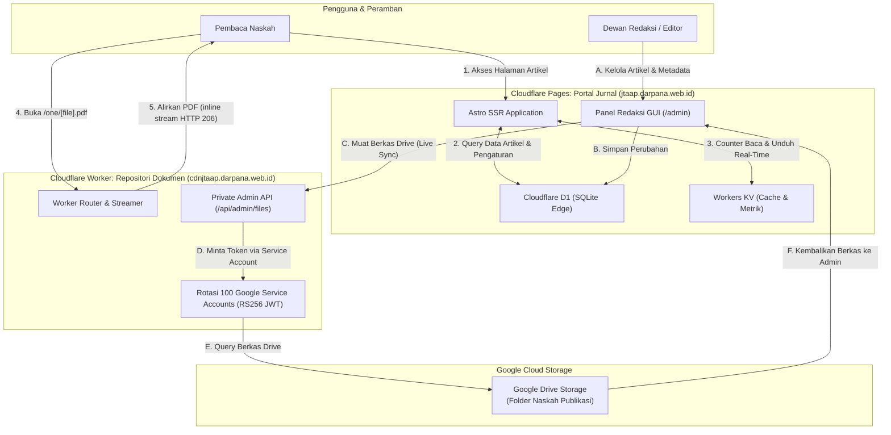
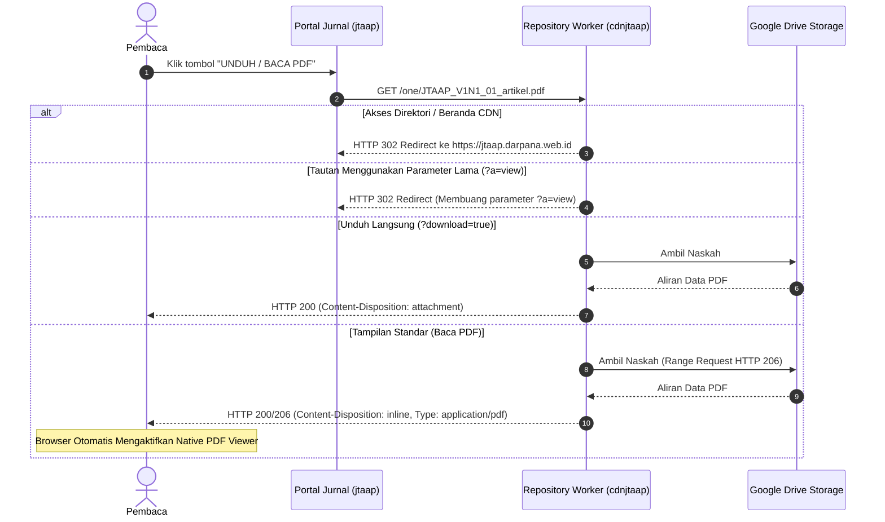

# JTAAP: Jurnal Terbuka Audit, Akuntansi, dan Pajak

Platform web publikasi jurnal ilmiah modern berbasis **Astro + Tailwind CSS** yang dirancang untuk di-host 100% tanpa biaya di **Cloudflare Pages**, terintegrasi dengan **Cloudflare D1** (SQLite Relasional di Edge), **Cloudflare Workers KV** (Global Edge Cache & Real-Time Metrics), dan repositori penyimpanan PDF terdistribusi via **Cloudflare Repository Worker** dengan rotasi 100 Google Service Accounts.

Diterbitkan oleh **BN Organization** bekerja sama dengan **Bawera Nitijana Research** untuk mengelola naskah ilmiah pada rumpun keilmuan Audit, Akuntansi, dan Perpajakan.

---

## 1. Diagram Arsitektur Sistem (System Architecture)



---

## 2. Diagram Alur Baca & Unduh Dokumen (PDF Reader Flow)



---

## 3. Fitur Utama

1. **Classic OJS 2-Column Layout:** Struktur visual 100% presisi mengikuti standar Open Journal Systems (proporsi 68% naskah, 32% sidebar standarisasi, tombol PDF khas, dan nomor halaman rata kanan).
2. **Native Browser PDF Viewer:** Naskah dibuka menggunakan engine PDF bawaan browser (Chrome, Edge, Firefox, Safari) yang dilengkapi *thumbnail page*, seleksi teks, *smooth scroll*, tombol cetak, dan unduh tanpa beban script pihak ketiga yang lambat.
3. **Sequential Multi-Drive Routing:** Alamat naskah mencerminkan urutan drive penyimpanan yang elegan (`/one/`, `/two/`, `/three/`), dengan tetap mendukung kompatibilitas format lama (`/0:/`).
4. **100% GUI Admin Dashboard (/admin):** Pengelolaan lengkap tanpa perlu mengedit file kode secara manual:
   * Tambah & terbitkan naskah baru.
   * Kelola dewan redaksi, reviewer, dan profil jurnal.
   * **Manajemen Berkas Google Drive (Live):** Melihat daftar seluruh file PDF di Google Drive secara langsung, menyalin tautan resmi, dan memilih berkas untuk form penerbitan.
5. **Rotasi 100 Service Accounts (GCP):** Repositori dokumen bebas dari batasan kuota unduhan akun tunggal karena ditenagai oleh 100 service accounts Google Cloud Platform yang berotasi otomatis.
6. **Google Scholar Metadata Ready:** Meta tag sitasi akademik otomatis (`citation_title`, `citation_author`, `citation_pdf_url`, `citation_volume`, `citation_issue`, dll.) terisi otomatis untuk pengindeksan mesin pencari ilmiah.
7. **Privasi Data Penuh:** Halaman direktori CDN tertutup total untuk publik. Pengunjung hanya dapat membaca berkas naskah resmi yang tautannya tersedia di portal.

---

## 4. Struktur Proyek

```text
sektansia-press/
├── repository-worker/          # Script Cloudflare Worker Repositori Dokumen
│   ├── worker.js              # Core Worker: Service Accounts, Router /one/, & Admin API
│   ├── wrangler.toml          # Konfigurasi deployment worker jttap
│   └── README.md              # Dokumentasi teknis repositori worker
├── src/
│   ├── components/            # Komponen UI OJS (Header, Sidebar, ArticleItem, dll.)
│   ├── config/                # Konfigurasi utama jurnal & generator URL
│   ├── data/                  # Data in-memory fallback
│   ├── lib/                   # Integrasi Cloudflare D1 & Workers KV
│   └── pages/                 # Routing halaman Astro (/admin, /article, /current, dll.)
├── schema.sql                 # Skema tabel database D1
├── seed.sql                   # Data awal penerbitan naskah
└── wrangler.toml              # Konfigurasi Cloudflare Pages
```

---

## 5. Cara Menjalankan Secara Lokal

```bash
# 1. Masuk ke direktori
cd sektansia-press

# 2. Instal dependensi
npm install

# 3. Jalankan server pengembangan
npm run dev
```
Buka browser di `http://localhost:4321`.

---

## 6. Cara Deploy

### Sekali Deploy Semua (Portal + CDN Worker):
```bash
npm run deploy
```
*Perintah ini otomatis men-deploy CDN Worker terlebih dahulu, melakukan build Astro, lalu men-deploy Portal Jurnal ke Cloudflare Pages.*

---

### Deploy Terpisah (Opsional):

**A. Deploy Portal Jurnal Saja (Cloudflare Pages):**
```bash
npm run deploy:portal
```

**B. Deploy CDN Repositori Saja (Cloudflare Worker):**
```bash
npm run deploy:cdn
```

---

## 7. Panel Administrasi Redaksi

* **URL:** `https://jtaap.darpana.web.id/admin`
* **Default Username:** `admin` | **Default Password:** `admin123`
* Di dalam menu **"Google Drive Index"**, klik tombol **"Muat Berkas Drive"** untuk melihat seluruh berkas yang ada di Google Drive dan memilihnya langsung ke formulir penerbitan naskah.
