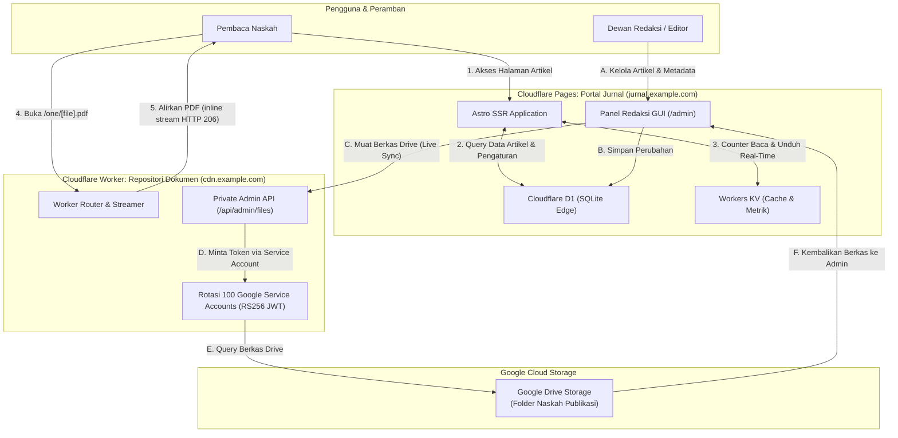
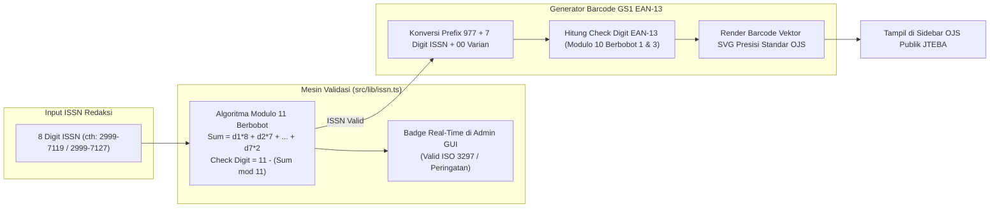
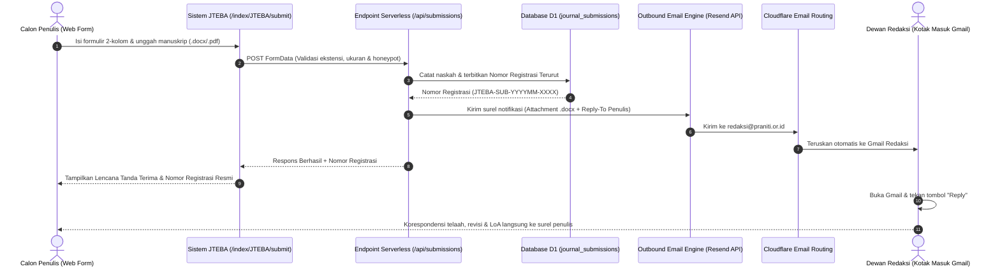

# JTEBA: Serverless Open Journal System (OJS)

Platform web publikasi jurnal ilmiah modern **JTEBA (Jurnal Terbuka Ekonomi, Bisnis, dan Akuntabilitas)** berbasis **Astro + Tailwind CSS** yang dirancang untuk di-host 100% tanpa biaya di **Cloudflare Pages**, terintegrasi dengan **Cloudflare D1** (SQLite Relasional di Edge), **Cloudflare Workers KV** (Global Edge Cache & Real-Time Metrics), dan repositori penyimpanan PDF terdistribusi via **Cloudflare Repository Worker** dengan rotasi Google Service Accounts. Presisi mengikuti estetika klasik Open Journal Systems (OJS) dengan performa edge ultra-cepat.

---

## 1. Diagram Arsitektur Sistem (System Architecture)



---

## 2. Diagram Alur Baca & Unduh Dokumen (PDF Reader Flow)

```mermaid
sequenceDiagram
    autonumber
    actor Reader as Pembaca
    participant Portal as Portal Jurnal (jurnal.example.com)
    participant CDN as Repository Worker (cdn.example.com)
    participant Drive as Google Drive Storage

    Reader->>Portal: Klik tombol "UNDUH / BACA PDF"
    Portal->>CDN: GET /one/JTEBA_V1N1_01_artikel.pdf
    alt Akses Direktori / Beranda CDN
        CDN-->>Portal: HTTP 302 Redirect ke https://jurnal.example.com
    else Tautan Menggunakan Parameter Lama (?a=view)
        CDN-->>Portal: HTTP 302 Redirect (Membuang parameter ?a=view)
    else Unduh Langsung (?download=true)
        CDN->>Drive: Ambil Naskah
        Drive-->>CDN: Aliran Data PDF
        CDN-->>Reader: HTTP 200 (Content-Disposition: attachment)
    else Tampilan Standar (Baca PDF)
        CDN->>Drive: Ambil Naskah (Range Request HTTP 206)
        Drive-->>CDN: Aliran Data PDF
        CDN-->>Reader: HTTP 200/206 (Content-Disposition: inline, Type: application/pdf)
        Note over Reader: Browser Otomatis Mengaktifkan Native PDF Viewer
    end

---

## 3. Diagram Alur Siklus Hidup Edisi & Terbitan JTEBA (Issue Lifecycle)

```mermaid
flowchart TD
    Start([Dewan Redaksi Buka /index/JTEBA/admin]) --> CheckStatus{Status Edisi Aktif?}

    CheckStatus -->|Naskah Belum Terbit / Volume Baru| ModeCFP["Mode Call for Papers Aktif (hasActiveIssue = false)"]
    ModeCFP --> RenderCFP["Halaman Beranda JTEBA & /current:<br/>Tampilkan Banner Call for Papers Resmi (Menuju Edisi Perdana)"]
    RenderCFP --> NoEmptyIssue["Sembunyikan Volume/Nomor Kosong dari Pengunjung Publik"]

    CheckStatus -->|Naskah Siap Rilis / Volume Aktif| ModeActive["Mode Edisi Aktif Terpublikasi (hasActiveIssue = true)"]
    ModeActive --> SelectIssue["Pilih Terbitan Terkini (Current Issue)"]
    SelectIssue --> RenderActive["Halaman Beranda JTEBA & /current:<br/>Tampilkan Volume & Daftar Artikel Ilmiah Lengkap"]

    subgraph IssueManager["Manajer Edisi & Terbitan JTEBA (/api/issues)"]
        AddIssue["1. Tambah Edisi Baru (Vol, Issue, Tahun, Tema)"]
        SetCurrent["2. Set sebagai Terbitan Terkini"]
        DeleteIssue["3. Hapus Edisi Kosong / Arsip"]
    end

    Start --> IssueManager
    IssueManager -->|Update Cloudflare D1 & Flush KV Cache| CheckStatus
```

---

## 4. Diagram Validasi ISSN ISO 3297 & Generator Barcode GS1 EAN-13



---

---

## 5. Diagram Alur Penyerahan Naskah Online & Penomoran Registrasi Otomatis



## 6. Fitur Utama

1. **Classic OJS 2-Column Layout:** Struktur visual 100% presisi mengikuti standar Open Journal Systems (proporsi 68% naskah, 32% sidebar standarisasi, tombol PDF khas, dan nomor halaman rata kanan).
2. **Native Browser PDF Viewer:** Naskah dibuka menggunakan engine PDF bawaan browser (Chrome, Edge, Firefox, Safari) yang dilengkapi *thumbnail page*, seleksi teks, *smooth scroll*, tombol cetak, dan unduh tanpa beban script pihak ketiga yang lambat.
3. **Sequential Multi-Drive Routing:** Alamat naskah mencerminkan urutan drive penyimpanan yang elegan (`/one/`, `/two/`, `/three/`), dengan tetap mendukung kompatibilitas format lama (`/0:/`).
4. **Validasi Numerasi ISSN ISO 3297 Modulo 11 & Barcode GS1 EAN-13 SVG:**
   * Pemeriksaan algoritma Modulo 11 berbobot otomatis (check digit 0–9 atau X) dengan umpan balik visual langsung (*badge* status) pada formulir admin JTEBA.
   * Pembuatan kode batang GS1 EAN-13 berbasis grafik vektor SVG presisi tanpa dependensi library eksternal, yang tampil di Sidebar OJS publik.
5. **Formulir Penyerahan Naskah Online Terpadu (Direct Web Submission):**
   * Antarmuka formal 2-kolom yang mengadopsi model kontak eksekutif Samsung CEO (*clean, readable, and accessible*).
   * Menghilangkan ketergantungan pada sekadar tautan email `mailto:` mentah atau chat instan tanpa jejak audit.
   * Dilengkapi proteksi anti-spam *honeypot* tanpa *captcha* visual yang membebani penulis.
6. **Penomoran Registrasi Naskah Otomatis di Edge D1 (`JTEBA-SUB-YYYYMM-XXXX`):**
   * Setiap naskah yang dikirimkan langsung memperoleh nomor registrasi unik berbasis urutan tahun-bulan dari tabel `journal_submissions` SQLite D1.
   * Lencana nomor registrasi dapat langsung disalin oleh penulis di layar tanda terima web.
7. **Notifikasi Surel Berkas Otomatis via Resend API dengan Dukungan `Reply-To`:**
   * Berkas manuskrip (.docx/.doc/.pdf s.d. 15 MB) dilampirkan otomatis ke surel pemberitahuan ke `redaksi@praniti.or.id`.
   * Integrasi header `Reply-To` memastikan ketika editor menekan tombol **"Reply" (Balas)** di Gmail, surel otomatis ditujukan ke calon penulis tanpa perlu menyalin alamat secara manual.
   * Utas percakapan (*thread*) di Gmail otomatis terkelompok rapi berkat nomor registrasi baku pada subjek surel.
8. **Modul Manajemen Naskah Masuk (*Submissions Studio*) di Panel Admin GUI:**
   * Tab khusus di `/index/JTEBA/admin` yang menyajikan tabel seluruh naskah masuk, tanggal penyerahan, profil penulis, berkas, status naskah, dan tombol kontak instan (Balas Surel & Chat WhatsApp).
   * Konfigurasi kunci API Resend langsung dari tab *Kontak & Narahubung* tanpa perlu deploy ulang.
9. **Siklus Hidup Terbitan & Mode Call for Papers Dinamis:**
   * Mendukung saklar mode *Call for Papers (Menuju Edisi Perdana)* jika JTEBA belum memiliki naskah rilis, sehingga halaman Beranda dan `/current` menyajikan informasi call for papers resmi tanpa menampilkan volume kosong.
   * Transisi instan ke *Mode Edisi Aktif Terpublikasi* saat terbitan resmi dirilis.
10. **Mesin Pencarian Naskah Multi-Parameter (`/search`):**
   * Pencarian terindeks dengan filter judul, abstrak, nama penulis, afiliasi organisasi, bidang kajian ilmiah (*Audit, Akuntansi, Pajak*), dan rentang tahun publikasi.
11. **Arsitektur Panel Administrasi 2-Tingkat (Two-Tier Admin Studio):**
   * **Level 1 - Admin Portal Open Gate (`/admin`):** Mengelola identitas organisasi penerbit (Praniti), kartu-kartu jurnal binaan, dan aset portal.
   * **Level 2 - Editorial Studio JTEBA (`/index/JTEBA/admin`):** Pengelolaan naskah terbit, dewan redaksi, legalitas ISSN, 4 panel edisi & terbitan, pengumuman, narahubung WhatsApp, Google Drive index, indeksasi, dan kredensial PIN redaksi.
   * Tab persisten berbasis `sessionStorage` dengan dukungan hash navigasi (`#form-add-new-issue`).
12. **Arsitektur Database SQLite D1 dengan Dynamic Partial Updates:**
   * Menggunakan query builder dinamis yang mencegah penimpaan kolom database yang tidak disentuh (misal: pengisian pengumuman tidak akan mereset data volume atau kontak).
   * Migrasi skema otomatis saat runtime untuk tabel `journal_issues` dan kolom pendukung.
13. **Rotasi 100 Service Accounts (GCP):** Repositori dokumen bebas dari batasan kuota unduhan akun tunggal karena ditenagai oleh 100 service accounts Google Cloud Platform yang berotasi otomatis.
14. **Google Scholar Metadata Ready:** Meta tag sitasi akademik otomatis (`citation_title`, `citation_author`, `citation_pdf_url`, `citation_volume`, `citation_issue`, dll.) terisi otomatis untuk pengindeksan mesin pencari ilmiah.
15. **Privasi Data Penuh:** Halaman direktori CDN tertutup total untuk publik. Pengunjung hanya dapat membaca berkas naskah resmi yang tautannya tersedia di portal.

---

## 7. Struktur Proyek

```text
JTEBA-Open-Journal-System/
├── repository-worker/          # Script Cloudflare Worker Repositori Dokumen
│   ├── worker.js              # Core Worker: Service Accounts, Router /one/, & Admin API
│   ├── wrangler.toml          # Konfigurasi deployment worker CDN jteba
│   └── README.md              # Dokumentasi teknis repositori worker
├── src/
│   ├── components/            # Komponen UI OJS (Header, SidebarOJS, ArticleItem, dll.)
│   ├── config/                # Konfigurasi utama jurnal & generator URL
│   ├── data/                  # Data in-memory fallback
│   ├── layouts/               # Layout dasar Astro dengan metadata akademik
│   ├── lib/                   # Integrasi Cloudflare D1, KV, dan modul ISSN
│   │   ├── db.ts              # Driver relasional SQLite D1 & pembaruan parsial
│   │   ├── cache.ts           # Global Edge KV Cache & metrik pembaca
│   │   ├── email.ts           # Mesin pengiriman surel & lampiran naskah via Resend
│   │   └── issn.ts            # Validasi ISO 3297 Modulo 11 & barcode GS1 EAN-13 SVG
│   └── pages/                 # Routing halaman Astro
│       ├── api/               # Endpoint REST API Serverless
│       │   ├── articles.ts    # API publikasi & kelola artikel
│       │   ├── auth.ts        # Verifikasi kredensial login & ganti PIN
│       │   ├── editorial.ts   # Kelola anggota dewan redaksi & reviewer
│       │   ├── indexing.ts    # Kelola pangkalan pengindeksan ilmiah
│       │   ├── issues.ts      # Manajemen volume, nomor edisi, & status rilis
│       │   ├── portal-*.ts    # API portal Open Gate Praniti
│       │   ├── settings.ts    # Pembaruan profil, identitas, & kontak jurnal
│       │   ├── submissions.ts # API penyerahan naskah online & registrasi D1
│       │   └── template.ts    # Endpoint penyaji berkas template manuskrip Word
│       ├── admin.astro        # Level 1: Panel Admin Portal Open Gate
│       ├── index/             # Portal Multi-Jurnal
│       │   └── JTEBA/         # Jurnal JTEBA
│       │       ├── admin.astro # Level 2: Editorial Studio GUI JTEBA
│       │       ├── archives.astro
│       │       ├── current.astro
│       │       ├── editorial-team.astro
│       │       ├── guidelines.astro
│       │       ├── index.astro
│       │       └── submit.astro
│       ├── article/           # Halaman detail naskah artikel ilmiah
│       └── search.astro       # Mesin pencarian artikel ilmiah multi-filter
├── schema.sql                 # Skema tabel relasional database D1
├── seed.sql                   # Data awal inisialisasi instalasi jurnal
└── wrangler.toml              # Konfigurasi Cloudflare Pages & D1/KV bindings
```

---

## 8. Cara Menjalankan Secara Lokal

```bash
# 1. Masuk ke direktori
cd JTEBA-Open-Journal-System

# 2. Instal dependensi
npm install

# 3. Jalankan server pengembangan
npm run dev
```
Buka browser di `http://localhost:4321`.

---

## 9. Cara Deploy

### Sekali Deploy Semua (Portal + CDN Worker):
```bash
npm run deploy
```
*Perintah ini otomatis men-deploy CDN Worker terlebih dahulu, melakukan build Astro, lalu men-deploy Portal Jurnal ke Cloudflare Pages.*

---

### Deploy Terpisah (Opsional):

**A. Deploy Portal Jurnal Saja (Cloudflare Pages):**
```bash
npm run deploy:portal
```

**B. Deploy CDN Repositori Saja (Cloudflare Worker):**
```bash
npm run deploy:cdn
```

---

## 10. Panel Administrasi 2-Tingkat (Two-Tier Admin Studio)

### A. Level 1: Admin Portal Open Gate (`/admin`)
* **URL:** `http://localhost:4321/admin`
* **Fungsi:** Mengelola identitas organisasi riset & penerbit (Praniti), kartu-kartu jurnal binaan, aset branding portal, dan autentikasi sesi portal.

### B. Level 2: Editorial Studio GUI JTEBA (`/index/JTEBA/admin`)
* **URL:** `http://localhost:4321/index/JTEBA/admin`
* **Default Username:** `admin` | **Default PIN / Password:** `admin123`
* **Navigasi Tab Terstruktur (Persisten via sessionStorage):**
  1. **Terbitkan Naskah:** Tambah naskah artikel baru lengkap dengan generator slug URL, input multi-penulis dinamis, abstrak, kata kunci, dan penomoran DOI resmi JTEBA.
  2. **Naskah Terbit:** Tabel daftar artikel yang telah rilis dengan penghitung unduhan, pratinjau PDF, dan dialog konfirmasi hapus aman.
  3. **Tim Redaksi:** Kelola Pemimpin Redaksi (*Editor-in-Chief*), dewan editor bidang, dan mitra bestari (*reviewer*), dilengkapi saklar *Visibilitas Publik Menu & Halaman Tim Redaksi*.
  4. **Profil Jurnal:** Pengaturan nama jurnal, inisial akronim, frekuensi, batas similarity Turnitin, organisasi penerbit (*publisher*), komunitas riset, alamat sekretariat, validasi real-time nomor e-ISSN/p-ISSN berstandar ISO 3297, serta pengunggah berkas logo, favicon, dan template Word (.docx).
  5. **Edisi & Terbitan:**
     * *Panel 1 (Status Publikasi):* Beralih antara *Mode Call for Papers (Menuju Edisi Perdana)* dan *Edisi Aktif Terpublikasi*.
     * *Panel 2 (Daftar Edisi & Terbitan):* Inventaris seluruh volume dan nomor terbitan beserta tombol *Jadikan Terkini* dan *Hapus*.
     * *Panel 3 (Tambah Edisi Baru):* Pendaftaran volume, nomor issue, tahun, periode bulan, tema edisi, dan cover.
     * *Panel 4 (Rincian Edisi Aktif):* Pengaturan detail teks volume aktif dan preview formula penomoran DOI per volume.
  6. **Pengumuman:** Formulir pembuatan kartu pengumuman redaksi atau *Call for Papers* di beranda JTEBA.
  7. **Kontak & Narahubung:** Pengaturan tombol WhatsApp cepat, email redaksi, serta saklar tampilan widget sidebar (Pengindeks, Tools, ISSN Barcode).
  8. **Google Drive Index:** Sinkronisasi live berkas PDF di Google Drive dan integrasi pemilihan berkas instan ke form penerbitan.
  9. **Indeksasi & Akreditasi:** Kelola pangkalan data pengindeks (Google Scholar, Garuda, Crossref, Dimensions, SINTA) beserta tautan dan ikon.
  10. **Keamanan:** Perbarui username login dan PIN rahasia dewan redaksi.

---

## 10. Daftar Serverless API Endpoints

| Endpoint | Method | Fungsi & Deskripsi |
|---|---|---|
| `/api/issues` | `POST` | Mengelola volume dan edisi terbitan (`add`, `delete`, `set_current`, `toggle_active`). |
| `/api/articles` | `POST` | Menerbitkan naskah baru, memperbarui metadata, atau menghapus artikel. |
| `/api/settings` | `POST` | Memperbarui profil, identitas legalitas penerbit, ISSN, dan narahubung jurnal via partial update. |
| `/api/editorial` | `POST` | Menambah, menyunting, atau menghapus anggota dewan redaksi dan mitra bestari. |
| `/api/indexing` | `POST` | Mengelola platform pengindeksan ilmiah dan status keterlihatan di sidebar. |
| `/api/auth` | `POST` | Otentikasi sesi admin GUI dan pembaruan kredensial PIN / username. |
| `/api/portal-*` | `POST` | Endpoint administrasi aset & kartu Open Gate Portal Praniti. |
| `/api/template` | `GET` | Menyajikan unduhan berkas template manuskrip Word (`.docx`) aktif. |

---

## 11. Panduan Setup CDN Repositori Dokumen & Service Accounts

Repositori dokumen naskah didukung oleh Cloudflare Worker yang menghubungkan penyimpanan Google Drive dengan pembaca jurnal menggunakan rotasi Service Account otomatis dan Native Browser PDF Viewer.

### A. Prasyarat yang Dibutuhkan
1. **Google Drive Storage**:
   * Sebuah folder Google Drive biasa atau Google Shared Drive tempat menyimpan file PDF artikel jurnal.
   * Ambil **ID Folder** dari tautan peramban: `https://drive.google.com/drive/folders/[FOLDER_ID]`.
2. **Kredensial Service Account (GCP)**:
   * 1 akun (atau hingga 100 akun untuk rotasi kuota tinggi) file JSON Service Account dari Google Cloud Console dengan API Google Drive aktif.
3. **Akun Cloudflare & Domain Aktif**:
   * Domain publik aktif di Cloudflare (contoh: `example.com`).
   * DNS atau Custom Domain untuk CDN dokumen (contoh: `cdn.example.com`).

---

### B. Langkah 1: Generate Service Account GCP

#### Metode 1: Membuat 1 Akun Service Account (Manual / Standar)
1. Buka [Google Cloud Console](https://console.cloud.google.com/) dan buat project baru.
2. Masuk ke **APIs & Services** > **Library**, cari **Google Drive API** lalu klik **Enable**.
3. Masuk ke **IAM & Admin** > **Service Accounts**, klik **Create Service Account** (beri nama bebas, misal `jurnal-repo`).
4. Klik akun yang dibuat > tab **Keys** > **Add Key** > **Create new key** > pilih format **JSON**.
5. Simpan file `.json` yang terunduh, lalu buka untuk melihat alamat `client_email`.
6. **Beri Akses Folder:** Buka Google Drive > klik kanan folder naskah > **Bagikan (Share)** > undang `client_email` sebagai **Pelihat (Viewer)**.

#### Metode 2: Membuat 100 Akun Service Account (Batch / Kuota Tinggi)
Untuk rotasi kuota otomatis dan pencegahan limit unduhan (750 GB/hari per akun), buat 100 Service Accounts via **Google Cloud Shell**:
1. Buka Cloud Shell di kanan atas console Google Cloud.
2. Jalankan perintah otomatisasi:
   ```bash
   PROJECT_ID=$(gcloud config get-value project)
   gcloud services enable drive.googleapis.com
   mkdir -p sa_keys && cd sa_keys

   for i in $(seq -w 1 100); do
     SA_NAME="sa-$i"
     gcloud iam service-accounts create "$SA_NAME" --display-name="SA $i"
     gcloud iam service-accounts keys create "$SA_NAME.json" \
       --iam-account="$SA_NAME@$PROJECT_ID.iam.gserviceaccount.com"
   done

   jq -s '.' sa-*.json > all_service_accounts.json
   ```
3. Unduh file `all_service_accounts.json` dari menu Cloud Shell.
4. **Trik Berbagi Folder ke 100 Akun via Google Groups:**
   * Buka [Google Groups](https://groups.google.com/), buat grup (misal: `jurnal-repo-team@googlegroups.com`).
   * Masukkan 100 email Service Account ke anggota grup.
   * Di Google Drive, cukup bagikan folder naskah ke **satu email grup** tersebut sebagai **Pelihat (Viewer)**.

---

### C. Langkah 2: Pasang Kredensial ke Worker
1. Salin file array JSON Service Account ke:
   ```text
   repository-worker/serviceaccounts.json
   ```
   *(File ini sudah otomatis diabaikan oleh `.gitignore` sehingga tidak akan bocor ke GitHub).*
2. Buka [`repository-worker/worker.js`](file:///d:/Gits/Private/JTEBA-Open-Journal-System/repository-worker/worker.js) dan sesuaikan:
   * `id`: Ganti `YOUR_GOOGLE_DRIVE_FOLDER_ID` dengan ID Folder Drive Anda.
   * `admin_token`: Ganti `your-secret-admin-token` dengan token rahasia pilihan Anda.
   * `PORTAL_URL`: Ganti dengan URL domain portal jurnal Anda (misal `https://jurnal.example.com`).

---

### D. Langkah 3: Deploy & Pasang Custom Domain
1. Deploy worker CDN dari komputer lokal:
   ```bash
   npm run deploy:cdn
   ```
2. Di dashboard Cloudflare:
   * Masuk ke **Workers & Pages** > pilih worker `jurnal-repository-worker`.
   * Buka **Settings** > **Domains & Routes** > klik **Add Custom Domain**.
   * Masukkan domain CDN (misal: `cdn.example.com`).
3. Di panel redaksi `/admin` portal jurnal (Tab Google Drive Index):
   * Masukkan URL CDN: `https://cdn.example.com/one`.
   * Klik tombol **Muat Berkas Drive** untuk memeriksa berkas secara langsung.

---

### E. Konfigurasi Lanjutan CDN (Direct Link, Pengalihan, Unduh & Hotlink)

1. **Pengalihan Otomatis ke Web Utama (Direct Link Redirection):**
   * Setiap akses langsung ke root CDN (`/`, `/one`, `/two/`, atau path yang berakhiran slash `/`) otomatis dialihkan (HTTP 302 Redirect) ke portal web utama (`PORTAL_URL`).
   * Halaman 404 menampilkan tautan langsung kembali ke web portal utama.
   * Konfigurasikan URL portal utama di `repository-worker/wrangler.toml`:
     ```toml
     [vars]
     MAIN_PORTAL_URL = "https://jurnal.example.com"
     ```
2. **Mode Penampil PDF vs Paksa Unduh Berkas:**
   * **Inline Stream (Standar):** `https://cdn.example.com/one/artikel.pdf` (Browser otomatis membuka Native PDF Viewer bawaan).
   * **Paksa Unduh (Download):** Tambahkan `?download=true` (contoh: `https://cdn.example.com/one/template-jurnal.docx?download=true`) agar browser langsung memunculkan dialog unduh.
   * Tautan lawas dengan parameter `?a=view` otomatis dibersihkan dengan HTTP 302 Redirect.
3. **Proteksi Akses & Anti-Hotlink (CORS):**
   * Di `repository-worker/worker.js`, ganti `cors_domain: "*"` menjadi domain web jurnal Anda (contoh: `cors_domain: "https://jurnal.example.com"`) untuk membatasi pemanggilan berkas hanya dari website resmi Anda.
4. **Hosting Template Manuskrip, Logo & Favicon Langsung di Google Drive CDN:**
   * Anda dapat meletakkan file template Word (`template-jurnal.docx`), file logo (`logo.png`), dan favicon (`favicon.png`) di folder Google Drive yang sama dengan PDF naskah.
   * Pasang tautan CDN-nya di Panel Admin (`/admin` > Profil Jurnal) untuk mengubah logo, favicon, atau template naskah secara instan tanpa menyentuh kode.

---

## 12. Setup Database Cloudflare D1 & Workers KV

Platform ini menggunakan SQLite relasional di edge (**Cloudflare D1**) untuk persistensi data artikel dan pengaturan redaksi, serta **Cloudflare Workers KV** untuk penghitung metrik (*views* & *downloads*) real-time dan cache performa tinggi.

> **Catatan:** Platform ini memiliki *fallback in-memory* otomatis. Saat dijalankan secara lokal (`npm run dev`), aplikasi tetap dapat berjalan langsung tanpa setup database terlebih dahulu.

### A. Langkah 1: Buat Database D1
Jalankan perintah berikut di terminal:
```bash
npx wrangler d1 create jurnal-db
```
Wrangler akan mengembalikan informasi database Anda. Salin `database_id` yang didapat ke file `wrangler.toml`:
```toml
[[d1_databases]]
binding = "DB"
database_name = "jurnal-db"
database_id = "MASUKKAN_DATABASE_ID_ANDA"
```

---

### B. Langkah 2: Eksekusi Skema Tabel (schema.sql & seed.sql)
Jalankan migrasi skema tabel dan data awal naskah ke database D1 produksi Anda:
```bash
# 1. Eksekusi struktur tabel relasional (artikel, redaksi, pengaturan)
npx wrangler d1 execute jurnal-db --remote --file=./schema.sql

# 2. Eksekusi data awal contoh naskah publikasi
npx wrangler d1 execute jurnal-db --remote --file=./seed.sql
```
*(Untuk pengujian database lokal, Anda dapat mengganti flag `--remote` menjadi `--local`).*

---

### C. Langkah 3: Buat Workers KV Namespace
Jalankan perintah berikut untuk membuat penyimpanan cache dan counter metrik:
```bash
npx wrangler kv:namespace create CACHE
```
Salin nilai `id` yang didapat ke file `wrangler.toml`:
```toml
[[kv_namespaces]]
binding = "KV"
id = "MASUKKAN_KV_NAMESPACE_ID_ANDA"
```

---

### D. Langkah 4: Sambungkan Bindings di Cloudflare Pages Dashboard
Agar website di Cloudflare Pages dapat terhubung ke D1 dan KV di lingkungan produksi:
1. Masuk ke [Cloudflare Dashboard](https://dash.cloudflare.com/) > **Workers & Pages**.
2. Pilih proyek Pages Anda.
3. Buka menu **Settings** > **Functions**.
4. Di bagian **D1 Database Bindings**, klik **Add binding**:
   * **Variable name:** `DB`
   * **D1 database:** Pilih `jurnal-db`
5. Di bagian **KV Namespace Bindings**, klik **Add binding**:
   * **Variable name:** `KV`
   * **KV namespace:** Pilih `CACHE`
6. Simpan pengaturan dan lakukan deploy ulang (`npm run deploy:portal`). Seluruh naskah, konfigurasi jurnal, dan counter metrik kini 100% aktif dan persisten di edge Cloudflare.
