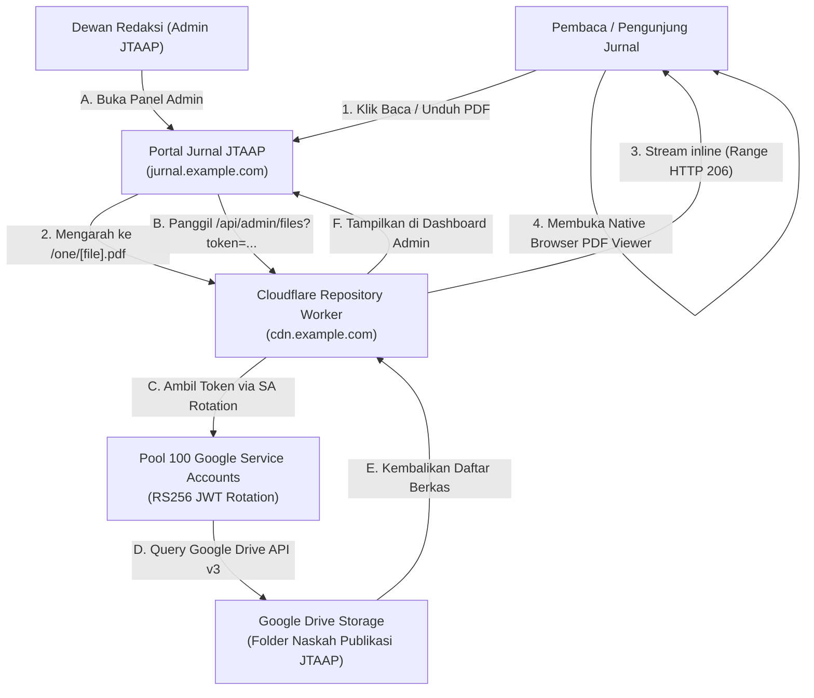
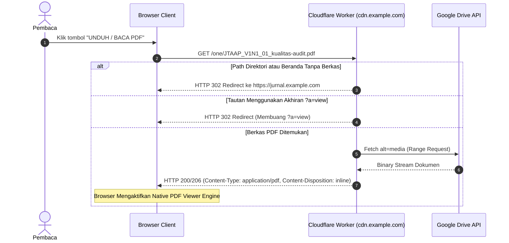

# JTAAP Document Repository Worker

Sistem backend Cloudflare Worker yang dirancang khusus untuk mengalirkan naskah dokumen jurnal ilmiah dari Google Drive dengan rotasi Service Account otomatis, antarmuka penampil dokumen bawaan peramban (*Native Browser PDF Viewer*), serta API privat untuk pengelolaan berkas dari Panel Redaksi JTAAP.

---

## 1. Diagram Arsitektur Proyek



---

## 2. Diagram Alur Permintaan Berkas (Request Flow)



---

## 3. Komposisi Tautan & Dukungan Multi-Drive

Sistem menggunakan penomoran semantik yang mencerminkan urutan drive penyimpanan (*sequential multi-drive support*):

| Prefix URL | Target Drive | Contoh Penggunaan |
| :--- | :--- | :--- |
| `/one/` atau `/1/` | Drive 0 (Utama) | `https://cdn.example.com/one/JTAAP_V1N1_01_artikel.pdf` |
| `/two/` atau `/2/` | Drive 1 (Cadangan/Arsip) | `https://cdn.example.com/two/JTAAP_V2N1_01_artikel.pdf` |
| `/three/` atau `/3/` | Drive 2 | `https://cdn.example.com/three/...` |
| `/0:/` *(Legacy)* | Drive 0 (Kompatibilitas) | `https://cdn.example.com/0:/...` (otomatis didukung) |

---

## 4. Fitur Utama

1. **Native Browser PDF Viewer**:
   * Dokumen disajikan dengan header `Content-Type: application/pdf`, `Content-Disposition: inline`, dan `Accept-Ranges: bytes`.
   * Memanfaatkan penampil PDF bawaan browser (Chrome, Edge, Firefox, Safari) yang dilengkapi *sidebar thumbnail*, seleksi teks, tombol cetak, dan tombol unduh.
2. **Penutupan Total Frontend Publik**:
   * Pengunjung tidak dapat menelusuri direktori, melihat struktur folder, atau mencari dokumen lain.
   * Setiap akses direktori publik otomatis dialihkan ke portal jurnal utama.
3. **Pool 100 Service Account (GCP)**:
   * Menggunakan 100 Service Accounts dengan rotasi token acak berbasis RS256 JWT (Web Crypto API).
   * Bebas dari batasan kuota Google Drive per-akun dan memiliki performa *high-throughput*.
4. **API Privat untuk Panel Admin**:
   * Endpoint: `GET /api/admin/files?token=TOKEN_RAHASIA`
   * Digunakan oleh panel redaksi JTAAP untuk memuat berkas naskah secara langsung, menyalin tautan resmi, dan memilih berkas untuk penerbitan artikel.

---

## 5. Konfigurasi Lanjutan CDN Repositori Dokumen

Cloudflare Worker repositori ini memiliki beberapa konfigurasi penting untuk mengontrol pengalihan direct link, proteksi akses, serta mode unduhan:

### A. Pengalihan Otomatis ke Web Utama (Direct Link Redirection)
* **Pengalihan Root & Direktori:**
  Jika ada pengunjung atau bot yang mengakses alamat root CDN (`https://cdn.example.com/`, `/one`, `/two/`, atau path yang berakhiran slash `/`), worker otomatis mengembalikan HTTP 302 Redirect ke alamat portal utama (`PORTAL_URL`).
* **Halaman 404 (Berkas Tidak Ditemukan):**
  Jika berkas yang diminta tidak ada di Google Drive, worker mengembalikan halaman HTML dengan pesan informatif dan tombol navigasi kembali ke beranda portal jurnal.
* **Cara Mengatur Alamat Portal Utama (`PORTAL_URL`):**
  Alamat web portal utama dapat dikonfigurasi melalui 3 cara (urutan prioritas):
  1. **File `private-config.json` lokal:**
     ```json
     {
       "portal_url": "https://jurnal.example.com"
     }
     ```
  2. **File `wrangler.toml` (Environment Variables):**
     ```toml
     [vars]
     MAIN_PORTAL_URL = "https://jurnal.example.com"
     ```
  3. **Cloudflare Dashboard:**
     Buka Worker > **Settings** > **Variables** > tambahkan variabel `MAIN_PORTAL_URL` dengan nilai URL web portal Anda.

---

### B. Mode Tampilan Penampil PDF vs Paksa Unduh (Force Download)
Worker mendukung dua mode pengaliran dokumen:
1. **Mode Penampil PDF Bawaan Peramban (Native Inline Viewer - Standar):**
   * **Format URL:** `https://cdn.example.com/one/JTAAP_V1N1_01_artikel.pdf`
   * **Header HTTP:** `Content-Disposition: inline`, `Accept-Ranges: bytes`
   * **Perilaku:** Browser modern langsung membuka penampil PDF interaktif dengan thumbnail halaman, fitur zoom, dan pencarian teks tanpa mengunduh file ke disk terlebih dahulu.
2. **Mode Paksa Unduh Berkas (Force Download / Attachment):**
   * **Format URL:** `https://cdn.example.com/one/JTAAP_V1N1_01_artikel.pdf?download=true`
   * **Header HTTP:** `Content-Disposition: attachment; filename="JTAAP_V1N1_01_artikel.pdf"`
   * **Perilaku:** Browser langsung memicu kotak dialog "Simpan Berkas" (Save As). Sangat direkomendasikan untuk berkas Microsoft Word (`.docx`), template naskah, atau arsip data (`.zip`).
3. **Pembersihan Parameter Warisan (`?a=view`):**
   * Jika ada tautan lawas yang mengakses `?a=view`, worker secara cerdas melakukan HTTP 302 Redirect untuk membuang query string tersebut dan menyajikan penampil inline yang bersih.

---

### C. Proteksi Hotlink & Konfigurasi Batasan Domain (CORS)
Pada objek `authConfig` di [`worker.js`](file:///d:/Gits/Private/sektansia-press/repository-worker/worker.js):
```javascript
const authConfig = {
  enable_cors_file_down: true,
  cors_domain: "*", // Atau batasi ke domain web portal Anda
  ...
};
```
* **Buka untuk Semua Domain (Default):** Nilai `cors_domain: "*"` mengizinkan pembaca dan mesin pencari akademik (seperti Google Scholar) memuat dokumen tanpa hambatan CORS.
* **Membatasi Anti-Hotlink:** Jika Anda ingin mencegah website luar menyematkan dokumen atau mencuri bandwidth CDN Anda, ganti nilai `cors_domain` menjadi domain resmi jurnal Anda, contoh: `cors_domain: "https://jurnal.example.com"`.

---

### D. Distribusi Berkas Template Jurnal, Logo & Favicon via CDN Worker
Anda dapat memanfaatkan folder Google Drive yang sama untuk menampung seluruh aset visual dan template resmi jurnal:
1. Unggah berkas `template-jurnal.docx`, `logo.png`, dan `favicon.png` ke folder Google Drive naskah Anda.
2. Tautan CDN untuk berkas-berkas tersebut otomatis tersedia:
   * **Template Manuskrip (.docx):**
     `https://cdn.example.com/one/template-jurnal.docx?download=true`
   * **Logo Jurnal (Header):**
     `https://cdn.example.com/one/logo.png`
   * **Favicon Jurnal (Tab Peramban):**
     `https://cdn.example.com/one/favicon.png`
3. Masuk ke **Panel Redaksi (Admin)** di `/admin` > tab **Profil Jurnal** > bagian **Identitas Visual & Berkas Template Naskah**.
4. Tempelkan tautan-tautan CDN di atas dan klik **Simpan Profil Jurnal**. Seluruh logo, favicon, dan tombol unduh template di seluruh portal otomatis terupdate ke tautan CDN tanpa perlu melakukan build atau deploy ulang portal!

---

## 6. Cara Deployment

Worker ini dikonfigurasi melalui file [`wrangler.toml`](file:///d:/Gits/Private/sektansia-press/repository-worker/wrangler.toml) pada direktori ini:

```bash
# Dari root proyek sektansia-press:
npm run deploy:cdn

# Atau langsung dari direktori worker:
cd repository-worker
npx wrangler deploy
```

---

## 7. Tutorial Setup CDN Repositori Dokumen dari Awal

Panduan ini ditujukan jika Anda ingin menduplikasi, mengatur ulang, atau menyiapkan CDN repositori dokumen untuk jurnal lain.

### A. Komponen yang Dibutuhkan
1. **Google Drive Storage**:
   * Sebuah Folder Google Drive biasa atau Google Shared Drive yang digunakan untuk menyimpan berkas-berkas PDF naskah jurnal.
   * ID Folder Google Drive (diambil dari URL browser: `https://drive.google.com/drive/folders/[FOLDER_ID]`).
2. **Kredensial Service Account (GCP)**:
   * Minimal 1 (atau hingga 100 untuk rotasi kuota) file JSON Service Account dari Google Cloud Platform Console dengan izin Google Drive API diaktifkan.
3. **Akun Cloudflare**:
   * Akun Cloudflare dengan domain aktif (misal: `example.com`).
   * Worker `jurnal-repository-worker` yang terhubung ke Custom Domain (misal: `cdn.example.com`).
4. **Wrangler CLI**:
   * Terpasang di komputer lokal (`npm install -g wrangler` atau via devDependencies proyek).

---

### B. Langkah 1: Persiapan Google Cloud Platform & Service Accounts

Service Account digunakan untuk mengakses Google Drive tanpa perlu login OAuth peramban atau token refresh yang rentan kedaluwarsa. Ada dua cara untuk membuatnya:

#### Metode 1: Membuat 1 Akun Service Account (Manual / Standar)
Cocok untuk publikasi reguler dengan traffic wajar:
1. Masuk ke [Google Cloud Console](https://console.cloud.google.com/) dan buat project baru.
2. Buka menu **APIs & Services** > **Library**, cari **Google Drive API** lalu klik **Enable**.
3. Masuk ke **IAM & Admin** > **Service Accounts**, klik **Create Service Account** (beri nama bebas, misal `jurnal-repo-sa`).
4. Klik pada Service Account yang baru dibuat > masuk ke tab **Keys** > **Add Key** > **Create new key** > pilih format **JSON**.
5. Simpan file `.json` yang terunduh. Salin nilai `client_email` di dalamnya.
6. **Beri Akses Folder:** Buka Google Drive > klik kanan folder naskah > **Bagikan (Share)** > masukkan `client_email` tersebut dengan akses minimal **Pelihat (Viewer)**.

---

#### Metode 2: Membuat 100 Service Accounts (Batch / Rotasi Kuota Tinggi)
Mekanisme yang saat ini aktif di worker ini menggunakan 100 Service Accounts (project `saf-...`). Setiap request pembaca akan memilih 1 SA secara acak, sehingga kuota unduh Google Drive (750 GB/hari) dan limit API calls terdistribusi merata ke 100 akun.

Anda dapat membuatnya otomatis dalam 2 menit menggunakan **Google Cloud Shell** di browser:

1. Buka [Google Cloud Console](https://console.cloud.google.com/) dan aktifkan **Cloud Shell** (ikon terminal di kanan atas).
2. Jalankan perintah otomatisasi berikut di terminal Cloud Shell:
   ```bash
   # 1. Tentukan ID Project GCP aktif
   PROJECT_ID=$(gcloud config get-value project)

   # 2. Aktifkan Google Drive API
   gcloud services enable drive.googleapis.com

   # 3. Buat folder untuk menampung kunci
   mkdir -p sa_keys && cd sa_keys

   # 4. Generate 100 Service Account dan unduh kunci JSON-nya
   for i in $(seq -w 1 100); do
     SA_NAME="sa-$i"
     gcloud iam service-accounts create "$SA_NAME" --display-name="SA $i"
     gcloud iam service-accounts keys create "$SA_NAME.json" \
       --iam-account="$SA_NAME@$PROJECT_ID.iam.gserviceaccount.com"
   done

   # 5. Gabungkan 100 file JSON menjadi satu array JSON
   jq -s '.' sa-*.json > all_service_accounts.json
   ```
3. Unduh file `all_service_accounts.json` melalui menu Cloud Shell (*Download File*).
4. Isi file `all_service_accounts.json` tersebut adalah array yang siap langsung ditempel ke `const serviceaccounts = [...]` pada `worker.js`.

---

#### Trik Berbagi Akses Folder ke 100 Service Account (Google Groups)
Jika menggunakan 100 Service Account, **jangan mengundang email satu per satu** ke Google Drive:
1. Buka [Google Groups](https://groups.google.com/) menggunakan akun Google Anda.
2. Buat grup baru (contoh: `jurnal-repo-sa@googlegroups.com`).
3. Masukkan ke-100 email Service Account ke dalam anggota grup tersebut (bisa langsung tempel daftar email yang dipisahkan koma).
4. Di Google Drive, klik kanan folder naskah > **Bagikan (Share)** > cukup undang **email Google Group** tersebut (`jurnal-repo-sa@googlegroups.com`) sebagai **Pelihat (Viewer)**. Seluruh 100 Service Account otomatis memiliki akses ke folder secara instan.

---

### C. Langkah 2: Konfigurasi Kode Worker (`worker.js`)
Buka file [`repository-worker/worker.js`](file:///d:/Gits/Private/sektansia-press/repository-worker/worker.js):

1. **Masukkan Kredensial Service Account:**
   Tempelkan array kredensial JSON service account ke variabel `const serviceaccounts = [...]` di bagian atas file.
2. **Atur ID Folder Google Drive (`roots`):**
   Gulir ke bagian `const authConfig`:
   ```javascript
   const authConfig = {
     siteName: "JTAAP Document Repository",
     service_account: true,
     service_account_json: randomserviceaccount,
     admin_token: "TOKEN_RAHASIA_PANEL_ADMIN", // Ganti jika diinginkan
     enable_cors_file_down: true,
     cors_domain: "*",
     roots: [
       {
         id: "YOUR_GOOGLE_DRIVE_FOLDER_ID", // ID Folder Google Drive Anda
         name: "Naskah Publikasi JTAAP (Volume 1)",
         type: "folder"
       }
     ]
   };
   ```
3. **(Opsional) Menambah Volume / Drive Baru:**
   Jika nanti ada Volume 2 pada folder Google Drive berbeda, cukup tambahkan entri kedua pada `roots`:
   ```javascript
   roots: [
     { id: "ID_FOLDER_VOLUME_1", name: "Volume 1", type: "folder" }, // Diakses via /one/
     { id: "ID_FOLDER_VOLUME_2", name: "Volume 2", type: "folder" }  // Diakses via /two/
   ]
   ```

---

### D. Langkah 3: Deploy Worker ke Cloudflare
1. Buka terminal di root `sektansia-press` dan jalankan:
   ```bash
   npm run deploy:cdn
   ```
2. Pastikan deployment berhasil dan menampilkan nama worker: `jurnal-repository-worker`.

---

### E. Langkah 4: Sambungkan Custom Domain di Cloudflare
1. Buka dashboard [Cloudflare Dashboard](https://dash.cloudflare.com/) > **Workers & Pages**.
2. Pilih worker `jurnal-repository-worker`.
3. Masuk ke tab **Settings** > **Domains & Routes** > klik **Add**.
4. Pilih **Custom Domain**, ketikkan domain CDN Anda (contoh: `cdn.example.com`), lalu klik **Add Custom Domain**.
5. Cloudflare akan otomatis membuatkan sertifikat SSL dan DNS record CNAME.

---

### F. Langkah 5: Sinkronisasi ke Portal Jurnal
Agar portal jurnal otomatis menautkan tombol unduh dan panel admin ke CDN baru:
1. Buka [`src/config/journal.ts`](file:///d:/Gits/Private/sektansia-press/src/config/journal.ts) dan pastikan base URL mengarah ke domain CDN:
   ```typescript
   storage: {
     provider: "gdrive-index",
     gdrive_base_url: "https://cdn.example.com/one"
   }
   ```
2. Pastikan database Cloudflare D1 tabel `journal_settings` memiliki key `gdrive_base_url` dengan nilai `https://cdn.example.com/one`.
3. Deploy portal dengan:
   ```bash
   npm run deploy:portal
   ```
